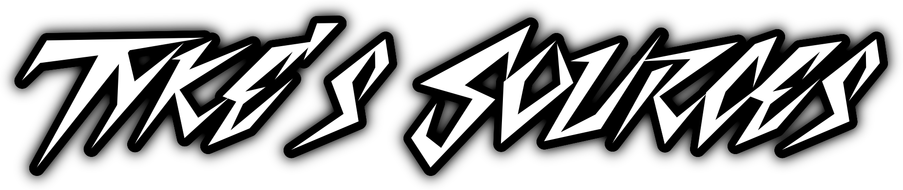

<p align="center"></p>

# Maintainer notes

How the site is built and edited. This is for the person who keeps the site updated, not for people hosting a copy.

The files: `index.html` (main page, the links are inside it), `tutorials.html` + `tutorials.js` (own tutorials), `faq.html` + `faq.js` (FAQ), and `style.css`, `common.js`, `scene.js` (the animated header on the Tutorials and FAQ pages), `bg.js` (shared look and code), and `logo.png` (the logo used in this file and the README, not on the site itself).

## Adding links

Open `index.html` and find the block marked `YOUR LINKS` near the bottom. A section is a name between `@@` marks. Inside it you can add groups, a name between `##` marks, then one link per line, with an optional description between `&&` marks:

```
@@Jailbreaks@@
##PS3 JAILBREAKS##
https://ps3.com
https://jailbreak.com &&allows jailbreak to system&&

@@Music@@
https://bandcamp.com
```

- `@@Jailbreaks@@` makes the big heading and its button in the top bar. Section buttons look like shell folders (`jailbreaks/`, `movies-tv/`), with a blinking cursor on the one you are reading. **Tutorials** and **FAQ** are normal buttons on the right.
- `##PS3 JAILBREAKS##` makes a sub-heading inside that section (a single `#` on each side works too). Add as many groups as you like.
- `&&allows jailbreak to system&&` adds a short description to the link. It shows under the name, and search looks in it. Leave it off for no description.
- Links placed straight under a section, with no group, show without a sub-heading.
- Tags go at the very end of the line, one `^` per tag (see **Tags** below).
- Add `$star` at the very end of a line to star a link (see **Stars** below).
- Blank lines are ignored.
- Names are generated from the domain. To override, add `| Custom Name` after the URL, before any description: `https://site.com | Name &&description&&`.
- Sections appear in the order they are written.
- A YouTube link (or your own video file) placed under a group goes into that group's **Tutorials** dropdown arrow, shown right next to the group name, instead of a normal link tile. Groups with no videos get no arrow:

```
@@Jailbreaks@@
#PS3 JAILBREAK#
https://ps3.com
https://www.youtube.com/watch?v=VIDEO_ID | How to jailbreak a PS3
```

## Stars

Put `$star` at the very end of a line to mark your most recommended links. A starred link gets a gold star and a gold outline, and searching `starred` finds all of them:

```
@@Jailbreaks@@
##PS3 Jailbreak##
https://jailbreak.com &&this jailbreaks it&& ^playstation $star
```

- `$star` works after the description and tags, and on tutorial videos too. `$starred` does the same.
- Searching `star` also finds them.

## Tags

Add searchable tags to any link (or tutorial) with `^` at the end of the line, after the description:

```
https://jailbreak.com &&helps you jailbreak&& ^playstation
https://site.com | Custom Name &&description&& ^xbox ^pc ^vr
https://site.com ^switch,pc
```

- One `^` per tag, or separate tags with commas (`^xbox,pc`). Tags are one word each, so use `^nintendo` rather than `^nintendo switch`. Group headings on the Tutorials page accept several too (`##Name## ^xbox,playstation`); the first one with a known icon is used.
- Tags show as small bubbles on the link and are searched along with the name, description and domain. Searching `xbox` finds every link tagged `^xbox`.
- A tag that matches your search ranks the link just below a name match.
- A `^` inside a `&&description&&` is left alone.

Some tags get a colour and an icon automatically. Any other tag is a plain purple bubble.

| Colour | Icon | Tags that use it |
| --- | --- | --- |
| Green | Xbox | `xbox` `xbox360` `xboxone` `xboxseries` |
| Blue | PlayStation | `playstation` `ps` `ps1`-`ps5` `psp` `psvita` `vita` |
| Red | Nintendo | `nintendo` `switch` `wii` `wiiu` `3ds` `ds` `gamecube` `n64` |
| Orange | PC | `pc` `windows` |
| White | VR | `vr` `quest` `oculus` `psvr` |
| Grey | Mobile | `mobile` `android` `ios` `iphone` `ipad` `phone` |

To add your own alias (say `deck` for orange PC), add it to the matching list in the `KINDS` line of `index.html`.

## Your own tutorials page

There are two kinds of tutorials. The ones under each group (YouTube links, see **Adding links**) stay on the main page in each group's Tutorials dropdown. The **Tutorials** button in the top bar opens a separate page for your **own tutorials**, such as videos on a file host like catbox. Each group there gets its **own page** and a **button with an icon**. Open `tutorials.js` and edit the `TUTORIALS` block:

```
##PS3 Jailbreaks## ^playstation
https://files.catbox.moe/abc123.mp4 | How to jailbreak a PS3 | Full walkthrough from start to finish.
https://files.catbox.moe/def456.mp4 | Installing homebrew | What you need after the jailbreak. $star

##iPhone & iPad##
videos/ios-sideload.mp4 | Sideloading apps | A short guide.
```

- `##Group##` starts a group. It becomes a button and its own page, for example `tutorials.html#ps3-jailbreaks`.
- Each video line is `address | Title | Description`. The description is optional. `&&description&&` at the end of the line works too.
- The address can be a catbox link (`files.catbox.moe` or `litter.catbox.moe`), any direct link ending in `.mp4`, `.webm`, `.ogv`, `.mov` or `.m4v`, a YouTube link, or a file in a `videos` folder next to `index.html`. Pixeldrain `api/file` links are detected too. If a host's address does not end in a video extension, add `$video` at the end of the line.
- Browsers can only play MP4 (H.264) and WebM reliably. Convert MKV or AVI files before uploading. If a video cannot load, the card shows a message with an "Open the file" button.
- The button icon is picked automatically from the group name (`PS3`, `Xbox`, `Switch`, `iPhone`, `Quest`...) or a tag on one of its videos. To choose it yourself, add a tag after the group name, like `##Random## ^pc`. Groups with no match get a play icon.
- Add `$star` to star a video. Lines starting with `//` are ignored. Don't use backticks in `tutorials.js`.

## Adding FAQ questions

Open `faq.js` and edit the `FAQ` block. A line starting with `?` is a question, and the lines under it are the answer (one paragraph per line). Plain `https://` addresses in an answer become links. A line like `##Tutorials##` starts a category heading (optional). Lines starting with `//` are ignored. Don't use backticks.

```
##Help##
?How do I suggest a link?
Join the Discord from the main page.
```

The FAQ page gets a search box, an Expand all button and a Discord button at the bottom automatically. The Discord link is in `faq.html`.

## The T logo

The T in the top bar can link to your own website. Near the top of the main script in `index.html`, set `HOME_URL` to your address, for example `const HOME_URL="https://example.com";`. Left empty, the T scrolls back to the top of the page.

## Links open in the same tab

Every link and button (link tiles, the Tutorials and FAQ buttons, Discord, GitHub, the T) opens in the tab you are already in. Use the back button to return.

## Search

Typing in the search box opens a frosted dropdown under it, like a browser address bar. The page underneath stays as it is. The dropdown has four blocks: **Sections**, **Groups**, **Results** (matched on name, description, tags and domain) and **Tutorials** (the group dropdown videos). It only searches the main page, not the Tutorials or FAQ pages. Matches are highlighted.

- Click a section or group to jump to it. Click a result to open it.
- Arrow keys move through the list, Enter opens the first result, and Esc clears the search and closes it.
- Clicking anywhere outside the box closes it. Clicking back into the search box reopens it.
