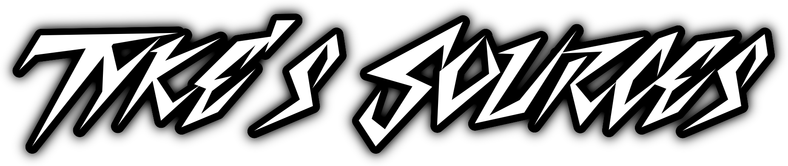

An offline copy of my site, so you can run it on your own computer or host it on a NAS or home server. I keep it updated, so to get the latest version just replace the files with the newest download.

## What is in the folder

- `index.html` – the main page. Open this one.
- `tutorials.html` and `faq.html` – the Tutorials and FAQ pages.
- `tutorials.js`, `faq.js`, `style.css`, `common.js`, `scene.js`, `bg.js` – the content, look and code the pages need.
- `logo.png` – the logo shown at the top of this file.
- `videos` – my own tutorial videos, including `how-to-edit-the-site.mp4`.

Keep everything together in one folder. The pages stop working properly if you move a file out on its own.

## Run it

- **On your computer:** double-click `index.html`. It works straight from the folder, there is nothing to install.
- **On a NAS or web server:** copy the whole folder into the folder your web server shares (the web root, for example the web share on a Synology, QNAP or similar NAS). Then open the address of that folder in your browser.
- **Docker:** `docker run -d -p 8080:80 -v /path/to/this/folder:/usr/share/nginx/html:ro nginx:alpine`, then open http://localhost:8080
- **Python:** run `python3 -m http.server 8080` inside the folder, then open http://localhost:8080

## What needs internet

The site, its fonts and its animations all run from these files with no internet. A few extras load from the web when you are online:

- the small icons next to each link (from DuckDuckGo)
- YouTube tutorials and their thumbnails
- the links themselves, which of course open other websites

Offline, icons show a letter instead and YouTube tutorials will not play. Everything else still works.

## Using the site

- The top bar jumps to each section. **Tutorials** and **FAQ** open their own pages.
- Search finds links by name, description, tag or website. Searching `starred` shows my most recommended links, marked with a gold star.
- Every link opens in the same tab. Use the back button to return.
